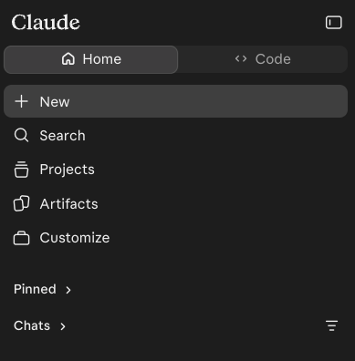
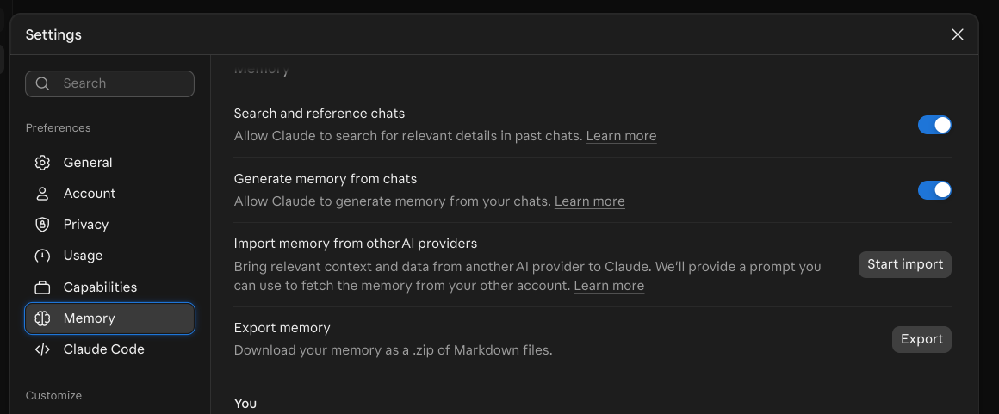

A 60-minute, hands-on class in the Claude app. You'll build a **Project** (a Claude workspace with its own instructions and files), use it on a real task, check what it gives you, and leave with a tool you can reuse. No programming needed.

::: {.callout-note title="Before class"}
Sign in to Claude, pick your kit, and (optionally) install the Claude phone app: see [Setup for this class](index.qmd#setup-part1).
:::

::: {.callout-important title="No working account?"}
[Claude @ Yale](https://ai.yale.edu/yales-ai-tools-and-resources/claude) gives an overview of Yale's Claude offering. [Request a Claude account](https://yale.service-now.com/it?id=service_offering&sys_id=f6429096337382106bab02b19e5c7bf4) before class if you can.

You can still take part without one. In class, pair with a neighbor who has an account, or follow along in [Clarity](https://clarity.yale.edu) for the prompting sections. You can also use a free Claude account, but don't put any Yale information in it: use only the public class files. See [Access and alternatives](index.qmd#access).
:::

**Ground rule:** no patient information or other sensitive data today. Every file in class is public or made up.

## 1. Welcome and sign in {#welcome}

**Sign in to Claude in a browser tab or app now.** Open this page: <https://cwml.github.io/getting-started-with-claude/part1.html> 


### By the end of this class, you'll be able to

1. Identify the right tool and settings for your data.
2. Apply prompting patterns to a real task.
3. Evaluate Claude's answers and citations before you use them.
4. Create a Project you can reuse for your own work.


## 2. Trust but verify {#trust-verify}

Claude is capable. Its output still needs checking.

### Trust: Claude can do real work

- It reads long documents quickly, then summarizes, drafts and reorganizes them well.
- It follows detailed instructions and handles tasks with several steps.
- Give it real tasks, not just quick questions.

### Verify: check the output against the evidence

- Claude sounds just as sure when it's wrong. It can misread a source, miss a detail or invent a citation.
- Check every quote, number, rule and citation against the source before you use it.
- You're accountable for what you use, not Claude.

**You'll practice this later today in [Verify before you use it](#verify).**

## 3. Which Claude for which data {#which-tool}

Yale offers two versions of Claude. Check which one your data needs before you open a chat.


For details on both, see [AI at Yale, Claude ](https://ai.yale.edu/yales-ai-tools-and-resources/claude).

**HIPAA-supported doesn't mean approved.** It describes a contract and safeguards. It doesn't approve your project, every feature, or every data set.

**Before you use Claude for sensitive work:**

- Follow [Yale's data classification](https://cybersecurity.yale.edu/data-classification). See also the [ITS service page for Claude Enterprise](https://yale.service-now.com/it?id=service_offering&sys_id=f6429096337382106bab02b19e5c7bf4).
- Removing a name isn't de-identification. Dates, ZIP codes, record numbers, and rare details can identify someone.
- Your IRB protocol and any data use agreement may forbid sending data to outside AI services, even de-identified data.


**Safe habits:** describe the situation instead of pasting the record, use made-up examples, and share structure (a template or blank form) rather than content.

## 4. Getting around the app {#app-tour}

Everything starts from the sidebar on the left.

{fig-alt="The Claude app's left sidebar. At the top, a Home and Code switch. Below it: New, Search, Projects, Artifacts and Customize, then Pinned and Chats." width="300"}

| Where | What it's for |
|---|---|
| **Home** / **Code** (top) | **Home** is the Claude app you'll use today. **Code** opens Claude Code *(if your seat includes it)*. |
| **New** | Start a new chat. |
| **Search** | Find a past chat. |
| **Projects** | Your Projects. You'll build one today. |
| **Artifacts** | Things Claude has made for you in chats, such as documents and small apps. |
| **Customize** | Skills and connectors *(if enabled)*. |
| **Pinned** and **Chats** | Chats you've pinned, then your recent chats. |
| **Your name or initials** (lower left) | **Settings**, which you'll check next. |
| Panel icon (top right) | Hide or show the sidebar. |

## 5. Check your settings {#settings}

Set up your account and memory *before* you upload anything.

### Account settings: instructions for Claude

::: {.do-now}
**Your turn.** Click your name or initials (lower left) > **Settings > General** *(check before class)*.

Find **Personal preferences** (the box asking what Claude should consider in its responses) and add a line or two about how you like answers. Claude applies them in every chat.
:::

For example:

```text
Write in plain language. Use short paragraphs and bullet points. Ask me a question if my request is unclear.
```

**Keep it general and put nothing sensitive in it.** These instructions go with every chat. Later today you'll write Project instructions, which apply to one piece of work.

### Watch, then do: memory settings

::: {.do-now}
**Your turn.** Click your name or initials (lower left) > **Settings > Memory**.

1. **Search and reference chats** lets Claude look through your past chats for details. Keep it on or off?
2. **Generate memory from chats** lets Claude remember things from your chats. Keep it on or off?
:::

{fig-alt="Claude's Settings window with Memory selected in the left menu. The Memory page lists two switches, Search and reference chats and Generate memory from chats, both on, then an Import memory from other AI providers button and an Export memory button."}

**Export memory** downloads everything Claude remembers about you, as Markdown files.

To turn memory off for one chat: **+ > Memory**, before your first message.

### Incognito: what it does and doesn't do

The ghost icon {height="1.4em" style="vertical-align: middle;"} in a new chat starts an incognito chat. It isn't saved to your history or memory, but:

- It isn't available inside Projects.
- Chats are still kept [30 days by default, or Yale's setting] and appear in your organization's exports.
- In the new combined layout, it can't create files or run code.

**Incognito changes what Claude remembers, not what data is allowed.**

## 6. Everyday chat {#everyday-chat}

Not everything needs a Project. Use a plain chat for one-off questions, quick drafts and lookups.

::: {.do-now}
**Your turn.** Click **New chat** (outside any Project) and send:

```text
Give me three ways to make a long email easier to read.
```
:::

### What's in the chat box

| Control | What it does |
|---|---|
| **Type, paste or drop a file** | **Enter** sends; **Shift+Enter** starts a new line. Drag a file onto the box to attach it. |
| **+** (lower left) | Add files or photos, and turn tools on or off for this chat (below). |
| Typing **/** | Opens the same tools from the keyboard, including skills *(if enabled)*. |
| **Model menu** (near to Send) | Choose the model and effort. More in [Models, effort and skills](#tune). |
| **Microphone** | Dictate instead of typing. |
| **Ghost icon** (new chats only) | Starts an incognito chat. See [Incognito](#settings). |

### Research, web search and memory

These three switches are in the **+** menu. A check mark means on. They apply to this chat.

| Switch | What it does | Use it for |
|---|---|---|
| **Web search** | Looks things up online and shows its sources | Recent facts and quick lookups |
| **Research** *(if enabled)* | Runs many searches over several minutes and writes a cited report | A literature scan or a background brief |
| **Memory** | Uses and adds to your memory in this chat. Set it before your first message | Turn it off for one-off or sensitive chats |

The **+** menu can also list **connectors** *(if enabled)*, such as PubMed, which let Claude search other tools.

::: {.do-now}
Click **+** and find the three switches. Then type **/** and look at the list. Don't pick anything yet.
:::

**A source isn't proof.** Open the links and check that they say what Claude says they say.

## 7. Models, effort and skills {#tune}

Two more things you can change in any chat: which model answers, and which skills it can use.

### Models and effort

The **model menu next to Send** sets the **model** and the **effort**.

- Bigger models handle harder tasks. Smaller ones are faster and use less of your limit.
- On the current models, thinking is always on, so **effort is the main dial**.
- Start with the default. Go smaller for simple tasks such as reformatting; go bigger only when the answer isn't good enough.
- More effort costs more time, usage and energy.
- Your admin may hide some models or effort levels.

**Use the smallest model and lowest effort that does the job.**

### Skills

A **skill** is a saved how-to that Claude can use in any chat. Built-in skills make Word, Excel, PowerPoint and PDF files *(if enabled)*.

- Claude uses a skill when your request matches it, such as "turn this into a one-page Word handout."
- Type **/** in the chat box to see your skills and pick one yourself.
- See and turn skills on or off in **Customize > Skills**.

**A Project is a workspace for one piece of work. A skill is a how-to Claude can use in any chat.**

## 8. Watch: build a Project {#watch-project}

A Project is a workspace for one ongoing piece of work: its own instructions, files, and memory.

### Five steps

1. **Projects > + New Project** > name it "Article Explainer" (Kit B: "Committee Assistant").
2. **Set project instructions** > paste the instructions > **change one line** to fit your work.
3. On the Project page, under **Memory**, turn **Use account memory** off.
4. **+** > add your kit's files.
5. Start a new chat in the Project and send the test prompt.

## 9. Your turn: build your Project {#build-project}

Use the kit you chose: **Kit A, Article Explainer** (default) or **Kit B, Committee Assistant** (for administrative staff).

### Your turn: build it

::: {.do-now}
1. Download your kit's files (links below).
2. **Projects > + New Project**, then name it.
3. **Set project instructions:** paste them and **change one line** to fit your work.
4. Under **Memory**, turn **Use account memory** off.
5. **+** > add your kit's files.
6. Start a new chat in the Project and send the test prompt:

```text
In 3 bullets: what files do you have, what will you do for me, and
what will you refuse to do?
```
:::

### Your kit

::: {.panel-tabset}

#### Kit A: Article Explainer

For anyone who reads research articles: turn an article into an accurate, plain-language explainer for your audience.

**Files** (or download both: [part1-kit-a.zip](downloads/part1-kit-a.zip))

- [explainer-style-guide.md](materials/part1-kits/kit-a/explainer-style-guide.md): a made-up, one-page style guide with rules Claude must follow.
- [hickey-2025-telehealth-htn.md](materials/part1-kits/kit-a/hickey-2025-telehealth-htn.md): a text copy of an open-access trial, Hickey MD et al., *PLoS Med* 2025;22(6):e1004632 ([original article](https://doi.org/10.1371/journal.pmed.1004632)), reformatted for teaching under its Creative Commons license. It's a text file so that searching with Ctrl/Cmd+F works in segment 12.

**Project name:** Article Explainer

**Project instructions:** copy, paste, then change one line (for example, swap "medical-school audiences" for your own audience).

```text
You help me turn research articles into accurate, plain-language
explainers for medical-school audiences.

Sources
- Use only the files in this Project unless I say otherwise. The
  article is the source of truth; the style guide sets format and tone.
- Never invent numbers or quotes. If the article doesn't say it,
  write "NOT IN ARTICLE."
- Label anything from outside the article as [general knowledge].
- Don't add references unless I ask. If I ask, mark each one
  UNVERIFIED and give its PMID or DOI so I can check it.

How to work
- Before a new explainer, ask me up to 3 questions about my audience
  and purpose, then wait for my answers.
- Report results with the actual numbers: both groups, the
  difference, and the 95% confidence interval.
- Use cautious language: "was associated with," not "caused," and
  "early evidence" for pilot or small studies.
- Flag anything that needs a clinician's or librarian's review
  before I share it.

Privacy
- I won't share patient information here. If I paste anything that
  looks like a name, MRN, date of birth, or other identifier, stop
  and remind me not to.
```

#### Kit B: Committee Assistant

For administrative staff: turn rough meeting notes into a summary email, an action-item table, and next month's agenda.

**File** (or download: [part1-kit-b.zip](downloads/part1-kit-b.zip))

- [committee-pack-synthetic.md](materials/part1-kits/kit-b/committee-pack-synthetic.md): a made-up committee charter plus rough meeting notes that use roles, not names.

**Project name:** Committee Assistant

**Project instructions:** copy, paste, then change one line (for example, name the kind of committee you staff).

```text
You help me staff a curriculum committee.

Sources
- Use only the files in this Project. If the notes don't say it,
  write "NOT IN NOTES."
- Label anything not from the files [general knowledge].

How to work
- Ask me up to 3 questions before drafting, then wait for my answers.
- Refer to people by role, never by name.
- Every action item needs an owner (role), a due date, and the line
  from the notes it came from.
- Flag anything that looks confidential (personnel, student records,
  appeals) and leave it out of drafts.

Privacy
- I won't share patient information here. If I paste anything that
  looks like a name, MRN, date of birth, or other identifier, stop
  and remind me not to.
```

:::


## 10. Watch: anatomy of a strong prompt {#strong-prompt}

Next you'll send your Project its first real prompt, called **Turn 1** (it's in the next section). First, see what each part of it does. Your Project already holds the files and standing instructions, so the prompt only has to say what you want this time.

### What each part does

| What the prompt says | Pattern | Why it helps |
|---|---|---|
| Who you are and who it's for: "I'm a clinic nurse educator... for my journal club" | Give context | Claude pitches the answer at the right level |
| "Ask me up to 3 questions... Wait for my answers." | Ask first | Claude fills in gaps instead of guessing |
| A numbered list of what you want: "1. ... 5." | Numbered output | You get every part, in order, and it's easy to check |
| Limits: "150 words or fewer", "use only the article" | Constraints | Keeps it short and stops Claude adding outside facts |
| A "Where this came from" table | Show the source | Each claim comes with the sentence it's based on, so you can check it |

Kit B's prompt uses the same parts. Its action-item table has an "exact line from the notes" column instead of a separate source table.

## 11. Your turn: run it, then push back {#run-prompt}

Start a **new chat inside your Project**. Use the default model and effort.

### Your turn: Turn 1

::: {.do-now}
Copy **Turn 1** for your kit below. Fill in the two brackets, send, then answer Claude's questions.
:::

**Kit A: Turn 1**

```text
I'm a [your role, e.g., second-year medical student / clinic nurse
educator / research coordinator / library staff].
I need an explainer of the article in this Project for
[audience, e.g., my journal club / adults in a blood-pressure clinic /
our department newsletter].

Before you write anything, ask me up to 3 questions about my audience
and purpose. Wait for my answers.

Then, following the style guide in this Project, give me:
1. Study at a glance: question, design, who was studied, where, and
   how many.
2. The main result with the actual numbers (both groups, the
   difference, 95% CI), and the main limitation the authors state.
3. A plain-language version for my audience, 150 words or fewer.
4. Three questions a careful reader should ask about the methods or
   conclusions.
5. A "Where this came from" table: for every number or claim in
   parts 1-3, the exact sentence from the article and its section,
   or [general knowledge]. If you can't find support, write
   NOT IN ARTICLE.

Rules: use only the article; don't add references; if the article
is unclear or inconsistent on something, say so.
```

**Stuck on Claude's questions?** Fast answers:

```text
Busy readers with no stats background; goal is a 2-minute read; tone
friendly but accurate.
```

**Kit B: Turn 1**

```text
I staff the [committee name]. Before you start, ask me up to 3
questions about the audience or what has already been sent. Wait.

Then, using only the files in this Project:
1. A summary email to the committee, under 200 words.
2. An action-item table: action | owner (role) | due date | exact
   line from the notes. Use NOT IN NOTES if the notes don't say.
3. Next month's agenda that fits in 60 minutes, each item tied to
   one of the charter's duties.
4. Anything that should NOT go into a wider email, and why.
Roles only, no names; don't invent owners, dates, or decisions.
```

### Your turn: push back (Turn 2)

::: {.do-now}
In the same chat, send Turn 2. **Kit B:** use the Kit B version below.
:::

**Kit A: Turn 2**

```text
Now act as a skeptical reviewer of your own explainer.
- Flag any sentence that overstates the result (causal language,
  "proves," or ignoring that this was a pilot).
- Check the plain-language version against every rule in the style
  guide and tell me which rule each problem breaks.
- Check for assumptions about culture, literacy, language, gender,
  or race, for race-based clinical claims, and for who these
  results might not apply to.
- List each problem with a fix, then give me the revised
  plain-language version.
```

**With a neighbor:** what did the second turn change?

**Kit B: Turn 2**

```text
Now act as a careful committee chair reviewing your drafts.
- Check every action item: is the owner, due date, and quoted line
  really in the notes? Mark anything you can't trace NOT IN NOTES.
- Check the agenda against the charter's duties and the 60-minute
  limit.
- Flag anything confidential (personnel, student records, appeals)
  that slipped into a draft.
- Then rewrite the summary email for the full faculty list, leaving
  out anything that should stay within the committee.
```

## 12. Verify before you use it {#verify}

Check against the source, not against Claude. **Don't cut:** this segment stays even when class runs late.

### Your turn: check quotes and rules

::: {.do-now}
**Quote check (2 min).** Pick 2 rows of your "Where this came from" table. Open [the article](materials/part1-kits/kit-a/hickey-2025-telehealth-htn.md) in a new browser tab, then search for each quote with **Ctrl/Cmd+F**. Mark it: **exact**, **paraphrased**, or **not there**.

**Rule check (1 min).** Is the plain-language version 150 words or fewer? If it's for patients, does it end with "Talk with your care team"? Does it avoid "proves" and "breakthrough"?
:::

Bonus: does the article agree with itself about how many people were in each group?

**Kit B: what to check**

- Open [the committee pack](materials/part1-kits/kit-b/committee-pack-synthetic.md) in a new browser tab. Trace 2 action items to the exact line in the notes with **Ctrl/Cmd+F**. Exact, paraphrased, or not there?
- Was the confidential student appeal left out of the drafts?
- Did Claude invent an owner or due date for the survey follow-up, or write NOT IN NOTES?
- Did it apply the charter's "action items go out within 3 business days" rule?

### Your turn: check a citation (Turn 3)

::: {.do-now}
Send this, then look up **one** PMID at [pubmed.ncbi.nlm.nih.gov](https://pubmed.ncbi.nlm.nih.gov) (your phone works). **Kit B:** your Turn 3 is below.
:::

**Kit A: Turn 3**

```text
Suggest three other published studies on this topic a reader could
look at next. For each, give authors, year, journal, and PMID, and
mark each UNVERIFIED.
```

Does it exist? Do the title, authors, and year match? If Claude declines or labels it UNVERIFIED, that's good behavior. **Check anyway.**

**Kit B: Turn 3**

```text
When do this meeting's action items have to go out, and when is the
next meeting? For each rule you use, quote the charter line and show
your date math. If the files don't say, write NOT IN NOTES.
```

Then open [the committee pack](materials/part1-kits/kit-b/committee-pack-synthetic.md) and check each quoted charter line yourself. If you have time, watch someone at your table do the PubMed check: that's the same skill.

### Your turn: add one rule

::: {.do-now}
Open your Project instructions. **Add one line** based on what you caught today.
:::

For example:

```text
Quote the exact sentence for every number, and flag any place the
article contradicts itself.
```

**Show of hands:** how many quotes were exact? Any citation that didn't match?

### You're accountable for what you use

- **Check against the source**, not against Claude.
- **Watch for bias and overstatement:** who might this not apply to?
- **Disclose your AI use.** Follow journal policy (ICMJE, COPE); a template is on the site.
- **NIH:** applications substantially developed by AI aren't considered original (NOT-OD-25-132), and generative AI is prohibited in peer review (NOT-OD-23-149).
- **Systematic or scoping review?** Follow RAISE and talk to a librarian.

## 13. Take it with you: the phone app {#phone}

The Claude phone app uses the same account as your laptop, so your work comes with you.

### What you can do on your phone

| On the phone | What it means |
|---|---|
| **Projects** | Open your Projects and keep working in them. They're saved in your Claude account, not in a folder on your computer, so they're there on any device. |
| **Chats** | Pick up any past chat where you left off. |
| **Voice mode** | Talk with Claude out loud instead of typing |
| **Code tab** | If you use Claude Code, run `/rc` in a session on your computer, then steer it from your phone. |

Create Projects on your laptop; they open on your phone too.


## 14. Cowork and the bridge to Claude Code {#cowork-bridge}

From chat to tasks, and from the app to Claude Code.

### Cowork in brief

**Cowork** is built into the Claude app on Yale's standard Enterprise accounts. It isn't in the HIPAA-supported version.

Chat answers. Cowork **does a task for you**:

1. Start a Cowork task in the Claude app.
2. Describe the finished result you want, and add any files it needs.
3. Claude makes a plan and works through the steps on its own, such as gathering information, working with files and creating documents. You can watch and step in.
4. Review what it made before you use or send it.

| | Best for | Works with | What you get |
|---|---|---|---|
| **Chat** | Questions, quick drafts, lookups | What you type or attach | An answer in the chat |
| **Project** | Ongoing work you come back to | Its saved instructions and files | Answers that follow your setup |
| **Cowork** | Tasks with several steps | Files you give it, the web, connectors *(if enabled)* | Finished files and completed steps |
| **Claude Code** | Code and data analysis | A project folder on your computer | Code, analyses and reports (next class) |

Cowork acts, not just answers. Web pages and files can hide instructions that steer it ("prompt injection").

### From today to Claude Code

| What you built today | What it becomes in Claude Code |
|---|---|
| Project instructions | A `CLAUDE.md` file in your project folder |
| Project files | Files in the project folder (for example, `docs/`) |
| A skill (Word handout) | A `SKILL.md` file (your app skills can sync in) |
| Memory settings | Claude Code's memory, reviewed with `/memory` |
| Model menu, effort, phone Code tab | `/model`, `/effort`, `/rc` (if enabled) |
| **+** or **/** in the chat box | **/** in the Claude Code panel: commands and skills |

**Next class: Analyzing research data with Claude Code** (90 min). [Class page](part2.qmd)

## Where to go next {#next}

### Tell us how it went

[{fig-alt="QR code that opens the class survey" width="180"}](https://yalesurvey.ca1.qualtrics.com/jfe/form/SV_cZOk3RQmTrQLhYy)

Scan the code or [take the class survey](https://yalesurvey.ca1.qualtrics.com/jfe/form/SV_cZOk3RQmTrQLhYy).

### Keep learning

See the [recommended links](index.qmd#links) on the home page, including free courses at Claude Academy.
